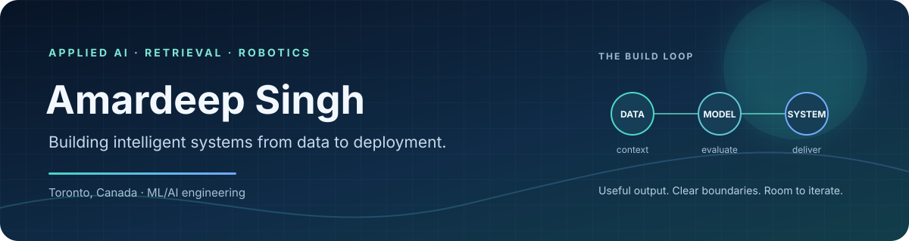
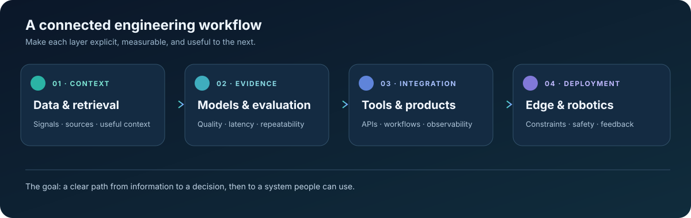
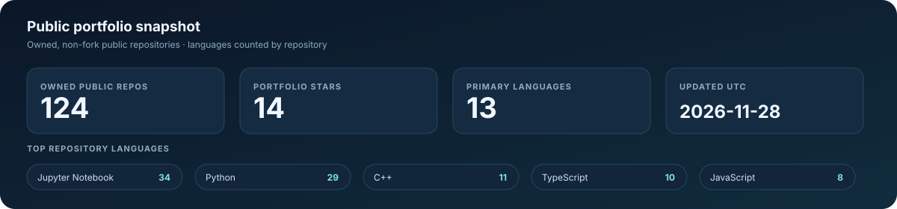

  

  

  <a href="#about">About</a> ·
  <a href="#selected-work">Work</a> ·
  <a href="#toolbox">Toolbox</a> ·
  <a href="#activity">Activity</a> ·
  <a href="https://github.com/AmDeep?tab=repositories">All repositories</a>

## About

I'm an ML/AI engineer based in Toronto, building practical systems across applied AI, retrieval, and robotics. I'm interested in the full path from data and model behavior to reliable tools, products, and edge deployments.

## Selected work

Each card is a link. Stars, language and last push come from the GitHub API and refresh daily.

<table>
  <tr>
    <td width="50%"></td>
    <td width="50%"></td>
  </tr>
  <tr>
    <td></td>
    <td></td>
  </tr>
  <tr>
    <td></td>
    <td></td>
  </tr>
</table>

<b>How I approach engineering</b>

- **Make behavior inspectable.** Keep inputs, outputs, assumptions, and evaluation visible.
- **Constrain before connecting.** Validate generated plans and commands at deterministic system boundaries.
- **Design for the whole path.** Treat data, inference, application interfaces, deployment, and observability as one system.

## Toolbox

  

<b>Full list</b>

- **Languages:** Python · C/C++ · TypeScript/JavaScript · SQL · R · MATLAB
- **AI/ML:** PyTorch · TensorFlow · scikit-learn · LangChain · LangGraph · vLLM
- **Robotics & systems:** ROS 2 · OpenCV · ONNX Runtime · TensorRT/Triton · MQTT · Docker · AWS · Azure

## Activity

<picture>
  
</picture>

Refreshed daily by GitHub Actions from public repository metadata. Language bars count each repository's primary language, not lines of code or skill level.

## Connect

Toronto, Canada · [GitHub](https://github.com/AmDeep) · [Omdena](https://www.omdena.com/)

