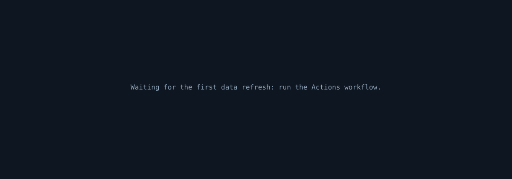

  <a href="#about">About</a> ·
  <a href="#selected-work">Work</a> ·
  <a href="#every-repository">Every repository</a> ·
  <a href="#insights">Insights</a> ·
  <a href="#toolbox">Toolbox</a> ·
  <a href="https://github.com/AmDeep?tab=repositories">All repositories</a>

## About

I'm an ML/AI engineer based in Toronto, building practical systems across applied AI, retrieval, and robotics. I'm interested in the full path from data and model behavior to reliable tools, products, and edge deployments.

## Selected work

<table>
  <tr>
    <td width="50%"></td>
    <td width="50%"></td>
  </tr>
  <tr>
    <td></td>
    <td></td>
  </tr>
  <tr>
    <td></td>
    <td></td>
  </tr>
</table>

<b>How I approach engineering</b>

- **Make behavior inspectable.** Keep inputs, outputs, assumptions, and evaluation visible.
- **Constrain before connecting.** Validate generated plans and commands at deterministic system boundaries.
- **Design for the whole path.** Treat data, inference, application interfaces, deployment, and observability as one system.

## Every repository

## Insights

Generated by GitHub Actions from public data for all repositories, refreshed every six hours. Language figures count the repository's primary language or bytes of code, not skill level.

## Toolbox

## Connect

Toronto, Canada · [GitHub](https://github.com/AmDeep) · [Omdena](https://www.omdena.com/)

