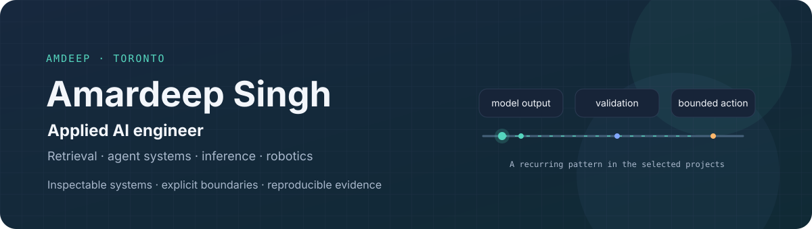
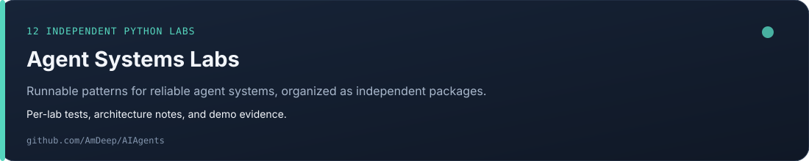
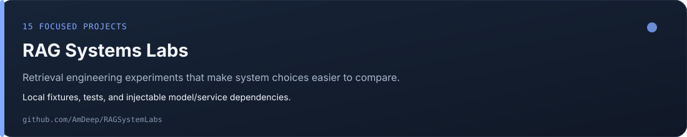
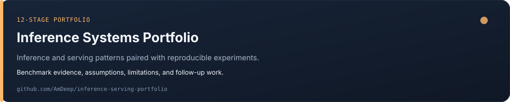
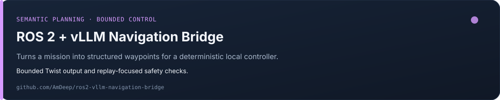
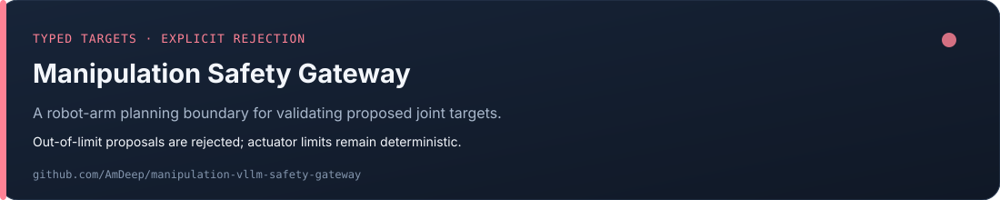
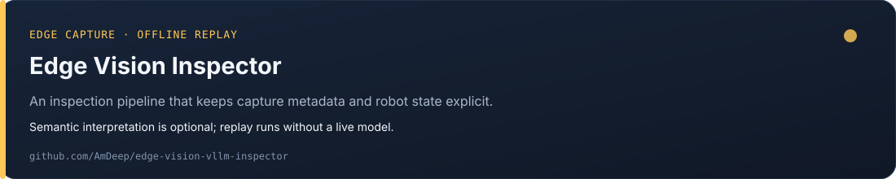
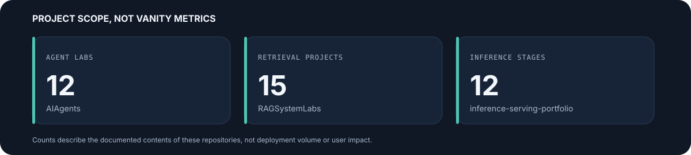
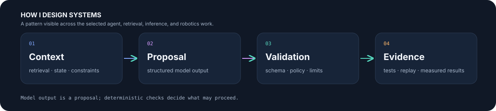

# Amardeep Singh

I build AI systems that are easier to inspect, test, and trust—from retrieval and agent workflows to bounded robotics interfaces.

**Toronto, Canada · Retrieval · agent systems · inference · robotics**

<a href="https://github.com/AmDeep">GitHub</a> · <a href="https://www.omdena.com/">Omdena</a>

## Selected work

<table>
<tr><td width="50%" valign="top">
<strong><a href="https://github.com/AmDeep/AIAgents">Agent Systems Labs</a></strong> Runnable patterns for reliable agent systems, organized as independent packages. <em>Evidence:</em> Per-lab tests, architecture notes, and demo evidence.
</td><td width="50%" valign="top">
<strong><a href="https://github.com/AmDeep/RAGSystemLabs">RAG Systems Labs</a></strong> Retrieval engineering experiments that make system choices easier to compare. <em>Evidence:</em> Local fixtures, tests, and injectable model/service dependencies.
</td></tr>
<tr><td width="50%" valign="top">
<strong><a href="https://github.com/AmDeep/inference-serving-portfolio">Inference Systems Portfolio</a></strong> Inference and serving patterns paired with reproducible experiments. <em>Evidence:</em> Benchmark evidence, assumptions, limitations, and follow-up work.
</td><td width="50%" valign="top">
<strong><a href="https://github.com/AmDeep/ros2-vllm-navigation-bridge">ROS 2 + vLLM Navigation Bridge</a></strong> Turns a mission into structured waypoints for a deterministic local controller. <em>Evidence:</em> Bounded Twist output and replay-focused safety checks.
</td></tr>
</table>

More robotics and edge projects

**<a href="https://github.com/AmDeep/manipulation-vllm-safety-gateway">Manipulation Safety Gateway</a>** — A robot-arm planning boundary for validating proposed joint targets. **Evidence:** Out-of-limit proposals are rejected; actuator limits remain deterministic.

**<a href="https://github.com/AmDeep/edge-vision-vllm-inspector">Edge Vision Inspector</a>** — An inspection pipeline that keeps capture metadata and robot state explicit. **Evidence:** Semantic interpretation is optional; replay runs without a live model.

## Live repository signals

<a href="https://amdeep.github.io/AmDeep/"><strong>Open the interactive portfolio dashboard →</strong></a>

Metrics cover owned public non-fork repositories. The monthly chart counts repositories by their latest push date, not commit volume.

## How I work

- Keep model outputs structured and inspectable.
- Validate proposals before they cross a tool or actuator boundary.
- Use tests, replayable examples, and explicit limitations as evidence.

## Areas of focus

**Applied AI:** agent systems · retrieval-augmented generation · inference and serving 
**Robotics and edge:** ROS 2 · model-to-control boundaries · edge vision · offline replay

The repositories are portfolio projects and reference implementations. Their READMEs describe setup, tests, assumptions, and limitations; no live deployment or business-impact claim is implied.

## Looking for

Interested in applied AI, retrieval, inference, and robotics problems where reliability matters.

---

Project visuals are generated from `profile-content.json`; live metrics come from public GitHub repository metadata. No third-party stats widgets or tracking badges.
