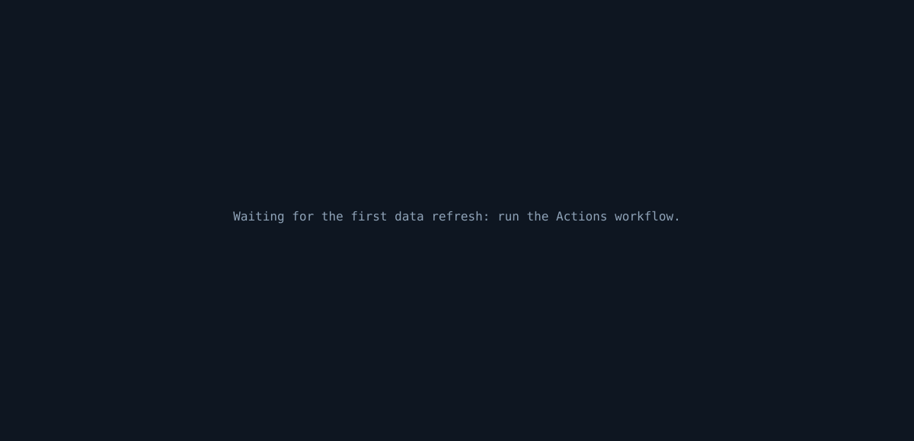
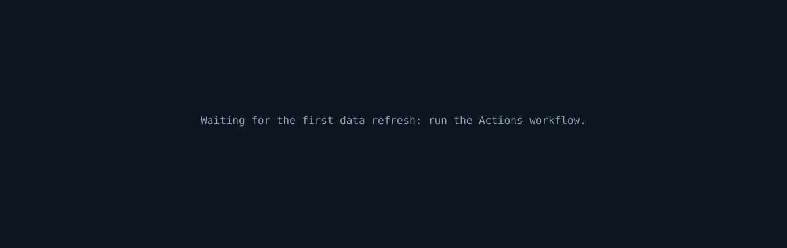

 

 

  <a href="#about">About</a> ·
  <a href="#selected-work">Selected Work</a> ·
  <a href="#live-metrics">Live Metrics</a> ·
  <a href="#repository-universe">Universe</a> ·
  <a href="#insights">Insights</a> ·
  <a href="#toolbox">Toolbox</a> ·
  <a href="https://github.com/AmDeep?tab=repositories">All Repositories</a>

  
  
  
  

---

## About

I'm an **ML/AI engineer** based in Toronto who builds systems that move from model output to **useful, inspectable action**.

I work across the full path: data contracts → inference → agent workflows → product interfaces → deployment → observability and safety boundaries.

**Focus areas**
- **Physical AI & robotics** — ROS 2 contracts, safety gateways, navigation bridges, fleet telemetry
- **Reliable agent systems** — grounded copilots, constrained planners, evaluation loops
- **Production ML** — serving, edge vision, typed schemas, fallback strategies
- **Product engineering** — Python services, React/TypeScript, APIs, cloud workflows

<b>Engineering principles</b>

- **Make behavior inspectable.** Keep inputs, outputs, assumptions, and evaluation visible.
- **Constrain before connecting.** Validate generated plans and commands at deterministic system boundaries.
- **Design for the whole path.** Treat data, inference, application interfaces, deployment, and observability as one system.
- **Prefer evidence.** Runnable labs, benchmarks, and typed contracts over slide-ware.

---

## Selected Work

<table>
  <tr>
    <td width="50%">
      
    </td>
    <td width="50%">
      
    </td>
  </tr>
  <tr>
    <td>
      
    </td>
    <td>
      
    </td>
  </tr>
  <tr>
    <td>
      
    </td>
    <td>
      
    </td>
  </tr>
</table>

---

## Live Metrics

  

  

  

<picture>
  <source media="(prefers-color-scheme: dark)" srcset="https://raw.githubusercontent.com/AmDeep/AmDeep/output/github-snake-dark.svg"/>
  <source media="(prefers-color-scheme: light)" srcset="https://raw.githubusercontent.com/AmDeep/AmDeep/output/github-snake.svg"/>
  
</picture>

---

## Repository Universe

---

## Insights

Custom visualizations are regenerated by GitHub Actions from public repository data.

---

## Toolbox

 

---

## Connect

**Toronto, Canada**

[GitHub](https://github.com/AmDeep) · [Omdena](https://www.omdena.com/)

Open to interesting problems in physical AI, reliable agents, and production ML systems.

 

