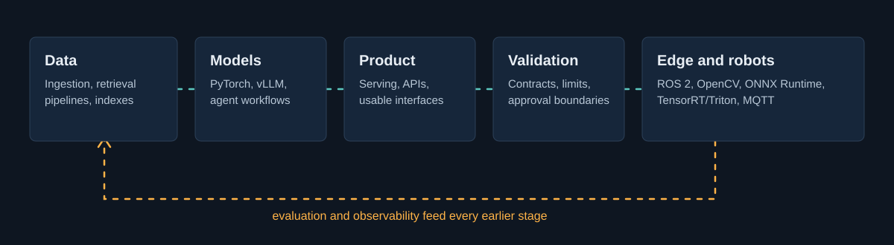

  

  

  <a href="#about">About</a> ·
  <a href="#selected-work">Selected Work</a> ·
  <a href="#live-metrics">Live Metrics</a> ·
  <a href="#insights">Insights</a> ·
  <a href="#toolbox">Toolbox</a> ·
  <a href="https://github.com/AmDeep?tab=repositories">All Repos</a>

  
  
  
  

---

## About

I'm an **ML/AI engineer** based in Toronto building practical systems that move from model output to useful, inspectable action — across applied AI, retrieval-augmented generation, physical AI / robotics, and edge deployment.

> I care about the full path: data contracts → inference → agent workflows → interfaces → deployment → observability and safety boundaries.

**Focus areas**
- Physical AI & robotics (ROS 2 contracts, safety gateways, navigation bridges, fleet telemetry)
- Reliable agent systems and grounded copilots
- Production-minded serving, evaluation, and edge vision
- End-to-end product engineering (Python services, React/TypeScript, APIs, cloud)

<b>How I approach engineering</b>

- **Make behavior inspectable.** Keep inputs, outputs, assumptions, and evaluation visible.
- **Constrain before connecting.** Validate generated plans and commands at deterministic system boundaries.
- **Design for the whole path.** Treat data, inference, application interfaces, deployment, and observability as one system.
- **Prefer evidence over claims.** Prefer runnable labs, benchmarks, and typed contracts over slide-ware.

---

## Selected Work

<table>
  <tr>
    <td width="50%"></td>
    <td width="50%"></td>
  </tr>
  <tr>
    <td></td>
    <td></td>
  </tr>
  <tr>
    <td></td>
    <td></td>
  </tr>
</table>

---

## Live Metrics

  
  

  

  

<!-- Contribution Snake (generated daily to output branch) -->

  <picture>
    <source media="(prefers-color-scheme: dark)" srcset="https://raw.githubusercontent.com/AmDeep/AmDeep/output/github-snake-dark.svg">
    <source media="(prefers-color-scheme: light)" srcset="https://raw.githubusercontent.com/AmDeep/AmDeep/output/github-snake.svg">
    
  </picture>

---

## Every repository

---

## Insights

Generated by GitHub Actions from public repository data (refreshed every ~6 hours).  
Language figures reflect primary language / code volume — not a skill ranking.

---

## Toolbox

  

---

## Connect

**Toronto, Canada** ·  
[GitHub](https://github.com/AmDeep) ·  
[Omdena](https://www.omdena.com/) ·  
Open to interesting problems in physical AI, reliable agents, and production ML systems.

---

Profile assets are data-driven SVGs regenerated by GitHub Actions.  
Snake animation lives on the <code>output</code> branch.  
Run the "Refresh profile" workflow after cloning to populate live numbers.

